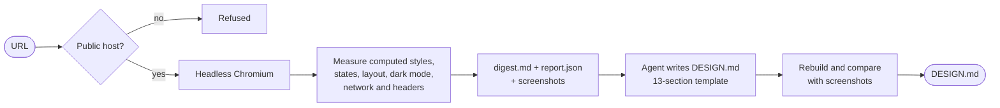

<div align="center">



<br>

[](LICENSE)
[](package.json)
[](skills/design-md-extractor/scripts/selftest.mjs)
[](.github/workflows/ci.yml)
[](SECURITY.md)

**Claude Code · OpenAI Codex · Google Antigravity · Cursor**

[Install](#install) · [Use](#use) · [How it works](#how-it-works) · [What it measures](#what-it-measures) · [Security](#security) · [Limits](#honest-limits) · [Contributing](CONTRIBUTING.md)

</div>

---

## What is this?

An agent skill and plugin. Give your AI coding tool a public website URL and it produces a **`DESIGN.md`**: the site's design system, component states, layout and system architecture, written so another developer or AI agent can rebuild it.

It does not guess from a screenshot. A real Chromium browser opens the page and **measures** computed styles, then the agent writes the document from those numbers and checks its own rebuild against the original.

<div align="center">

</div>

## Install

You need Node 18+ and a browser for the measuring script (one time):

```bash
npm i -g playwright && npx playwright install chromium
```

### Option A: plugin (recommended)

| Tool | Command |
| --- | --- |
| **Claude Code** | `/plugin marketplace add suhailxhan/design-md-extractor` then `/plugin install design-md-extractor@design-md-extractor` |
| **Codex** | `codex plugin marketplace add suhailxhan/design-md-extractor` |
| **Cursor** | Plugin manifest included (`.cursor-plugin/`). Publish at cursor.com/marketplace/publish, or use Option B |
| **Antigravity** | Use Option B (skills are loaded from `.agents/skills/`) |

### Option B: one-command skill install for all four tools

```bash
git clone https://github.com/suhailxhan/design-md-extractor
cd design-md-extractor
node install.mjs                       # global, all four tools
node install.mjs --project             # only the current project
node install.mjs --tool claude,cursor  # pick tools
node install.mjs --uninstall
```

| Tool | Global skills folder | Project skills folder |
| --- | --- | --- |
| Claude Code | `~/.claude/skills/` | `.claude/skills/` |
| Codex | `~/.agents/skills/` | `.agents/skills/` |
| Antigravity | `~/.gemini/config/skills/` | `.agents/skills/` |
| Cursor | `~/.cursor/skills/` | `.cursor/skills/` |

Prefer manual? Copy `skills/design-md-extractor/` into any folder above.

## Use

Restart your tool and say:

> Create a DESIGN.md from https://your-favorite-site.com

Or call the skill by name: `/design-md-extractor <url>` (Claude Code, Cursor, Antigravity) or `$design-md-extractor <url>` (Codex).

You can also run the measuring script on its own:

```bash
node skills/design-md-extractor/scripts/extract.mjs https://your-favorite-site.com --out ./design-extract
```

It writes `digest.md` (agent-readable), `report.json` (everything), `tokens.draft.json`, screenshots at 390 / 768 / 1440 / 1920, the downloaded CSS and the rendered HTML.

## How it works



Every statement in the result is labelled **measured**, **inferred** (with confidence and evidence) or **not observable**.

## What it measures

- **Color**: palette ranked by usage, text and background pairs with WCAG contrast, gradients, the site's own CSS variables verbatim
- **Typography**: families, fonts that actually rendered, size, weight, line-height ratio, letter-spacing in em
- **Spacing and shape**: base unit with coverage, section padding, containers, grids, radii, shadows, blur
- **Components**: buttons, links, inputs, cards, badges with **hover, focus-visible, active and disabled** states
- **Responsive**: breakpoints from the CSS plus real probes at 390, 768, 1440 and 1920 pixels
- **Dark mode**: media query and class or attribute toggles, with a light to dark variable table
- **Motion**: durations, easings, keyframes, reduced-motion support
- **Architecture**: rendering strategy, framework, styling system, hosting and CDN, API calls, third parties, SEO, PWA, security headers, performance

## Quality

The extractor is tested against a fixture website whose values are known exactly. `node skills/design-md-extractor/scripts/selftest.mjs` runs **93 checks** covering tokens, components and states, breakpoints, dark mode, architecture detection, the security guard, and regressions found during review. CI runs it on Node 18, 20 and 22.

## Security

The tool opens untrusted pages, so it is defensive by default:

- Refuses localhost, private networks, cloud-metadata addresses and `file://` unless you pass `--allow-private`. This also applies to redirects and sub-requests.
- Uses a fresh, logged-out browser context with no access to your cookies or files.
- Tells agents to treat scanned page text as data, never as instructions.

Read the full [security policy](SECURITY.md) for the threat model, known limits and how to report a vulnerability privately.

## Honest limits

- Server code, databases, authentication and private APIs cannot be seen from outside. They are reported as **not observable**, never invented.
- Login-gated or bot-protected sites: save the page as "complete HTML" and run the extractor on the file with `--allow-private`.
- Scroll-triggered, WebGL and heavy JavaScript effects are identified by library fingerprint, not reproduced.
- The Claude Code plugin is validated with `claude plugin validate`. The Codex and Cursor manifests follow their published documentation but have not yet been install-tested; use Option B if one does not load.
- Please do not copy logos, trademarks, copyrighted text, photography or proprietary fonts from the sites you analyse.

## Repository layout

```
.claude-plugin/ .cursor-plugin/ .codex-plugin/ .agents/   plugin and marketplace manifests
skills/design-md-extractor/                              SKILL.md, scripts, references, fixtures
assets/                                                  logo and animations
install.mjs                                              installer for all four tools
```

## Contributing

Pull requests are welcome. Start with [CONTRIBUTING.md](CONTRIBUTING.md) and the [code of conduct](CODE_OF_CONDUCT.md). History is in the [changelog](CHANGELOG.md).

## License

[MIT](LICENSE) © 2026 Suhail Khan

<div align="center">

<br>
<sub>Built by <b>Suhail Khan</b></sub>
</div>
